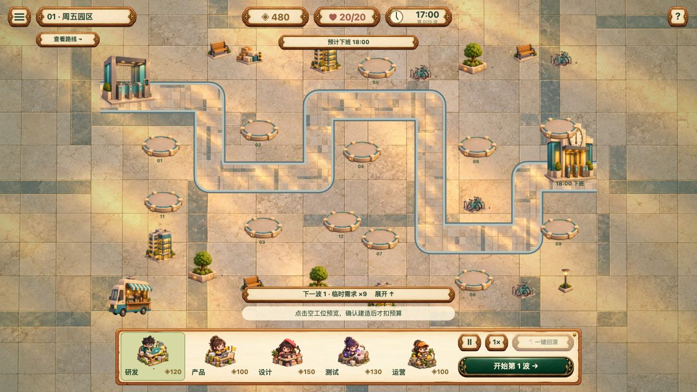
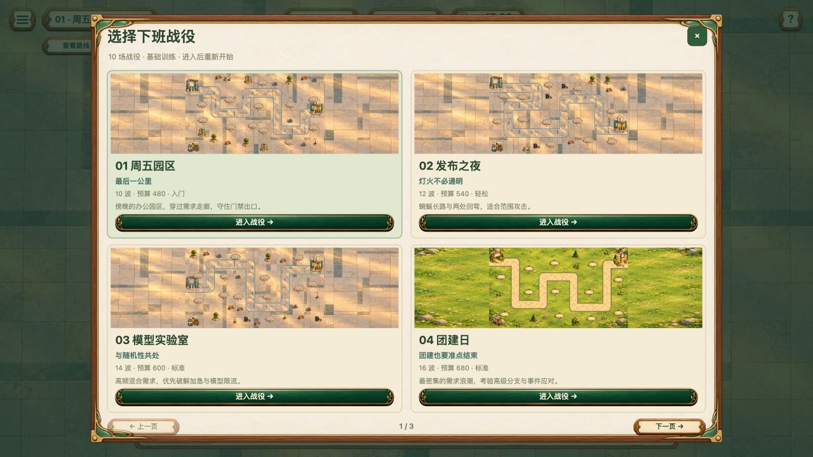

<div align="center">
  <a href="https://mepris.github.io/overtime-defense/">
    
  </a>

  <h1>保卫下班</h1>
  <p><strong>17:00，临时需求正在路上。你能守到 18:00 吗？</strong></p>
  <p>一款职场主题的浏览器塔防。把工位变成防线，把临时需求拦在门禁前。</p>
  <p><strong><a href="https://mepris.github.io/overtime-defense/">▶ 立即试玩</a></strong> · <a href="#实机画面">实机画面</a> · <a href="#快速上手">快速上手</a></p>
  <p>10 张地图 · 150 波 · 5 种职能 · 3 个阵营</p>
</div>

## 今天，准点下班

上线前的最后一个小时，线上 Bug、紧急插单和临时会议轮番来袭。用有限的预算布置团队，盯住每一波的敌人类型，把漏过门禁的需求压到最少。每漏掉一只，预计下班时间就会往后推。

| 你要做的决定 | 游戏里怎么玩 |
| --- | --- |
| **这波派谁守？** | 研发处理厚血需求，测试破盾，产品减速，设计清群，运营补预算。 |
| **把预算花在哪？** | 在回字环廊、折返路线和交叉路口找火力交汇点。进场先看路线，再选工位。 |
| **升专家还是带团队？** | 每个职能都有两条高阶晋升路线。看当前关卡缺单点火力、控场还是团队支援。 |
| **突发事件怎么救？** | 应对工具白名单切换、模型服务限流等随机事件。敌人快冲过防线时，用“一键回滚”争取时间。 |

## 实机画面

[](https://mepris.github.io/overtime-defense/)

*周五园区。点击工位预览攻击范围，确认建造后才扣预算。*

<details>
<summary>查看战役选择界面</summary>



</details>

## 快速上手

1. 打开 [在线试玩](https://mepris.github.io/overtime-defense/)，选一个工位，确认招募。
2. 展开“下一波”预警，按敌人的特征搭配职能。部署至少一名攻击职能后，点“开始第 1 波”。
3. 用击败敌人和完成波次赚到的预算补位、晋升。通关记录保存在当前浏览器。

| 快捷键 | 操作 |
| --- | --- |
| `1`–`5` | 切换职能 |
| 方向键 / `B` | 选择工位 / 预览 |
| `U` / `R` | 晋升 / 一键回滚 |
| 空格 / `Esc` | 暂停或继续 / 关闭面板 |

## 本地运行

```sh
git clone https://github.com/mepris/overtime-defense.git
cd overtime-defense
python3 -m http.server 4173 --directory dist
```

浏览器打开 [localhost:4173](http://localhost:4173/)。项目使用 Canvas 与随仓库提供的 Konva，启动无需安装前端依赖。

## 项目资料

- [玩法设计](DESIGN.md) · [职能与晋升](CAREERS.md) · [关卡平衡报告](BALANCE.md)
- [开发与版本记录](docs/development-notes.md) · [封面生成记录](docs/media/cover-prompt.md)
- 欢迎分享你的通关阵容、漏怪波次或改进建议。[反馈与讨论](https://github.com/mepris/overtime-defense/issues)
